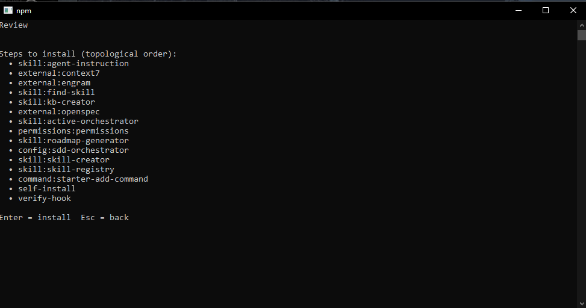
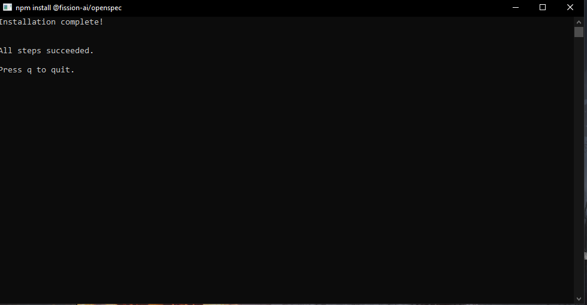

# Etapa 0 — Preparación del entorno

## Instalador de Active Stack

La evidencia visual conserva tanto la revisión previa de los componentes como el
resultado final de la instalación:



La pantalla de revisión lista, en orden topológico, los componentes seleccionados
para instalar; la captura siguiente confirma que todos esos pasos finalizaron:
`agent-instruction`, `context7`, `engram`, `find-skill`, `kb-creator`,
`openspec`, `active-orchestrator`, `permissions`, `roadmap-generator`,
`sdd-orchestrator`, `skill-creator`, `skill-registry`, `starter-add-command`,
`self-install` y `verify-hook`.



## Estado de la evidencia

| Evidencia pedida por la consigna | Estado |
|---|---|
| Plan de componentes del instalador | Incluido: `capturas/active-stack-plan-instalacion.png` (lista visible de 15 componentes). |
| Captura del instalador finalizado | Incluida: `capturas/active-stack-instalacion-completa.png` ("All steps succeeded"). |
| Listado documental de harnesses del repositorio | Incluido abajo, obtenido el 2026-10-09 mediante inventario de archivos. |
| Captura posterior de una pantalla de gestión de harnesses | No necesaria para la trazabilidad disponible: la primera captura conserva la lista que el instalador iba a ejecutar y la segunda confirma que todos los pasos finalizaron correctamente. |
| Repositorio nuevo y vacío al iniciar | Ver primer commit `b2540be` (`chore: initialize OPSX foundation`). |

## Comprobación CLI e inventario de harnesses (2026-10-09)

Se confirmó que el ejecutable está disponible en
`C:\Users\esteb\AppData\Local\active-stack\bin\active-stack.exe`. Las opciones
no interactivas consultadas no están soportadas por esta versión:

```text
> active-stack --help
unknown command: "--help"

> active-stack status
unknown command: "status"
exit=1
```

Sin argumentos, `active-stack` abre el menú interactivo con las opciones
`Install`, `Starters`, `Manage backups`, `Uninstall`, `Update stack` y `Quit`.
Por ello no fue posible obtener desde la CLI una salida de “lista de harnesses”
ni se afirma que exista una captura visual de ella.

El inventario reproducible de harnesses y artefactos activos dentro de este
repositorio encontró:

- `AGENTS.md` y `CLAUDE.md`: reglas del agente sincronizadas.
- `.active-orchestrator-state.json`: estado de la fundación.
- `.atl/skill-registry.md`: registro de skills del proyecto.
- `.agents/skills/openspec-{explore,propose,apply-change,archive-change,update-change,sync-specs}/SKILL.md`:
  skills OPSX disponibles en el checkout.
- `openspec/config.yaml`, la spec vigente y los dos changes archivados:
  artefactos del flujo OpenSpec.

Este listado es evidencia documental del checkout del 2026-10-09; una captura
de la interfaz del instalador sigue siendo una evidencia distinta y pendiente.
